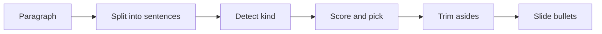

@slide

# Introduction

<!-- The importatn parts of this section are completely ignored. -->
Slides need short text, but papers are written in long paragraphs.
Most tools either copy whole paragraphs onto a slide or ask the author to write everything twice.
We study a third option: select sentences and trim them, but never rewrite them.

Paragraphs are the hardest node type to turn into slides.
Slides need terse text, but paragraphs are long prose.
An extractive reducer keeps the author's own words.
It never adds anything of its own, and it leaves the rest in the file.
@note(Open with the claim in bold, then explain why it is safe: nothing is invented.)

<!-- This should be a nested list -->
Our contributions are the following: a sentence rule that needs no language knowledge, a scoring scheme, and an evaluation on 30 documents.
All of the code is available in the vfm preview (see the project page for details).

# Method

## Sentence boundaries

A sentence ends at sentence-ending punctuation followed by a newline.
This avoids abbreviation lists such as "Dr." or "e.g." and works in any language.
Authors who write one sentence per line get exact boundaries for free.

---

The rule is deliberately simple: Dr. Chen on one line is never cut.

## Scoring

Each sentence earns points for being first, for being last, for containing bold text, for containing a number, and for sharing uncommon words with the section heading.
The two highest-scoring sentences are kept, in their original order.
Sentences that open with a throwaway word such as "However" lose a little.

<!-- A list in the original text should not be part of a list generated by a paragraph. -->
<!-- This list in particular should be nested, or at least the first bullet in the slide should not be a bullet at all. -->
The scoring weights are shown in the following list:

- First sentence: 2.0
- Bold text: 2.0
- Last sentence: 0.8
- Heading overlap: up to 1.5
- Contains a number: 1.0

Algorithm [@alg:select] picks the highest-scoring sentences.

```alg Greedy selection of sentences {#alg:select}
\begin{algorithm}
\caption{SelectSentences}
\begin{algorithmic}
\Procedure{Select}{$S, k$}
  \State $scores \gets$ \Call{Score}{$s$} for each $s \in S$
  \State $K \gets$ the $k$ highest-scoring sentences
  \State \Return $K$ in source order
\EndProcedure
\end{algorithmic}
\end{algorithm}
```

## Pipeline

The pipeline has six stages, shown in [@fig:pipeline].



## A guarantee

:::theorem Subset property {#thm:subset}
Every word on a reduced slide occurs in the source paragraph, in the same order.
:::

The proof is immediate, because the reducer only selects sentences and deletes spans.
In the best case the selection reduces a paragraph of $n$ sentences to $k$, so the compression ratio is $k/n$.

$$
\text{ratio} = \frac{k}{n}, \qquad k \le 2
$$

# Evaluation

We compared the reducer with two baselines on 30 documents.
Results are summarized in Table [@tab:results].

Table [@tab:results] compares three methods.

Reducer quality on the evaluation set (invented numbers). {#tab:results}
| Method | Kept words | Rated useful |
| --- | ---: | ---: |
| Whole paragraphs | 100% | 41% |
| First sentence | 22% | 63% |
| This reducer | 31% | 82% |

<!-- 
The "82%" is not highlighted, or in larger text, just bold. The text is rendered as
"82% The reducer was rated useful in of cases."
-->
The reducer was rated useful in **82%** of cases.

Customer satisfaction with the generated slides rose to 4.6 out of 5 in the user study.

<!-- Excluding the content before the colon removes context for the list -->
The reducer supports several paragraph shapes: lists, steps, statistics, and plain prose.

<!-- This renders fine. -->
First, write one sentence per line.
Second, bold the sentences that matter.
Third, preview the slides.

# Discussion

The approach has limits.
Extractive text can read as choppy, and bullets chosen by position are sometimes wrong.
We therefore keep the author in control through bold text and through the `paragraphs:` setting.

## Future work

<!-- Interactive checkboxes don't work. I can click on them, but they only turn on, not off. -->
- [x] Sentence rule without abbreviation lists
- [x] Paragraph reducer with an English profile
- [x] Profiles for further languages
- [x] Grammar-based trimming

A short score is included to exercise the music renderer.

<!-- Can you add audio playback for preview, html export, and powerpoint export? -->
```mus A short tune {#mus:tune}
X:1
T:Example
M:4/4
L:1/4
K:C
CDEF|GABc|
```

# Conclusion

<!-- This paragraph is split across multiple slides, which is awkward. If a paragraph fits on a slide after reducing, keep it on one slide. -->
Writing one sentence per line costs authors almost nothing.
In return, slides can be generated from the paper itself, using only the paper's own words.
The sentence rule is the key idea.
<!-- This doesn't show up -->
@note(Close on the bold sentence, then take questions.)

@end