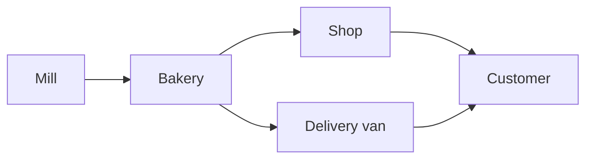

<!--
Everything below is wrapped in @slide ... @end, so slides mode shows it all.
Try: bolding or un-bolding a sentence, joining two lines into one, deleting the blank line
between paragraphs, adding `paragraphs: first-sentence` (or notes-only, full) to the header above.
Write one sentence per line: a sentence ends at . ! ? followed by a line break.
-->

@slide

# Why we started

<!-- Plain prose, five sentences, no bold: the first and last sentences should win. -->
We opened the bakery in the spring of 2019 with two ovens and a borrowed van.
The neighbourhood had no bread worth walking to, and the nearest supermarket sold the same loaf as everywhere else.
Our first customers were the people who lived above the shop, and most of them still buy from us on Saturdays.
Word of mouth did more for us than any advertising we ever paid for.
Looking back, the decision to start small was the best one we made.
@note(Keep this one personal. Mention the van.)

<!-- Bold marks the sentences that matter; they get a large bonus. -->
Our guiding idea has never changed.
**We bake what we would want to eat, and we sell it at a price we would be happy to pay.**
Everything else, from the opening hours to the choice of flour, follows from that.

---

<!-- A paragraph that is entirely bold is used exactly as written. -->
**Good bread takes time, and we refuse to hurry it.**

# What we sell

<!-- Colon + list: the intro stays as the parent bullet, the items are nested under it. -->
Our core range is small: sourdough, rye, seeded wholemeal, baguettes, and a weekly special.

We also bake pastries on weekends, including croissants, cardamom buns, and almond twists.

<!-- Brackets and a pair of commas are tidied away; the words that remain are the author's own. -->
The sourdough, which we feed every morning before dawn, is our best seller (we sell about two hundred loaves a week).
It uses a starter that is now older than the shop itself.

<!-- A real list after a paragraph that ends with a colon is nested under it. -->
The weekly special follows a simple rule:

- Something seasonal
- Something we have never baked before
- Something we can make at least thirty of

<!-- Statistic: one sentence built around a % or currency value becomes a big number. -->
Weekend sales now account for 62% of our weekly revenue.

<!-- Bold value without a leading word: the whole sentence stays as the caption. -->
Customers rated the sourdough **4.8** out of 5 in last year's survey.

# How a day works

<!-- Ordinals: a numbered list, with the ordinal words dropped. -->
First, the starter is fed and the ovens are lit at four in the morning.
Second, the dough that was shaped the evening before goes into the ovens in three batches.
Third, the pastries are laid out and the shop opens at seven.
Fourth, anything left at closing time is sold at half price or given to the food bank.
@note(This is a good place to pause for questions.)

<!-- A long paragraph (six or more sentences): it is split where the topic changes, and each part keeps its best sentences. -->
Our mornings are the busiest part of the day, and they set the tone for everything that follows.
By six o'clock the first trays are out and the shop smells of toast and warm butter.
Regulars arrive before seven and usually order the same thing without being asked.
The afternoons are different, because that is when we do the paperwork and talk to suppliers.
Our flour comes from a mill two hours away, and the owner delivers it himself every second Tuesday.
We pay a little more for it than we would at a wholesaler, but the bread is noticeably better.
Orders for the following week are placed on Friday, and any change must reach the mill by noon.

---

# The numbers

<!-- A table with a caption directly above it (no blank line between them). -->
Sales by product in our best month. {#tab:sales}
| Product | Loaves sold | Share |
| --- | ---: | ---: |
| Sourdough | 880 | 41% |
| Seeded wholemeal | 520 | 24% |
| Baguettes | 450 | 21% |
| Everything else | 300 | 14% |

<!-- Cross-references already print "Table 1": do not write the word "Table" before them. -->
Sourdough alone accounted for more than a third of the loaves we sold, as [@tab:sales] shows.
The remaining products are close to each other, and none of them is a clear second favourite.
This is why we rarely change the core range.
**Dropping the sourdough would cost us more than any other single change.**
We have never seriously considered it.

<!-- Figures, listings, thm environments, etc. should be centered. It looks like mermaid diagrams and scores are not centered. -->

<!-- A figure is numbered only if something references it (setting: vfmPreview.numberCaptions). -->
Figure [@fig:flow] shows the route an order takes.

# What we learned

<!-- The same-level headings below have no content between them: in a block of their own they would become a bulleted list. -->
## Start small

Small means you can afford to make mistakes.
Our first year was full of them, and almost none were expensive.
We changed the opening hours three times and the recipe for the baguette five times.
Because we only baked what we could sell, a bad week cost us a few trays instead of a few thousand pounds.

## Listen early

The best ideas came from customers standing at the counter.
The cardamom bun was suggested by a regular who had grown up in Sweden.
It is now our second most popular pastry, and she still gets the first one out of every batch.
We keep a notebook by the till and read it every Sunday.

<!-- These should be in one slide as a bulleted list -->
## a
## b
## c
## d

<!-- This should be on a separate slide since the section has content. -->
## Keep the routine

Routine is what lets a tiny team produce the same loaf every day.
We write down the temperature of the kitchen, the age of the starter, and the time each batch goes in.
When something goes wrong we can usually see why within a minute.
@note(Pause here. Ask the audience what routine they rely on.)

# Looking ahead

Next year we plan to open a second counter at the farmers' market.
That means more baking at night, which is the part nobody looks forward to.
We have decided to hire one more baker rather than ask the current team to work longer.
If the market stall works, we will think about a small café, but only if we can keep the bread the main attraction.
**Whatever we add, the bread comes first.**

@end
