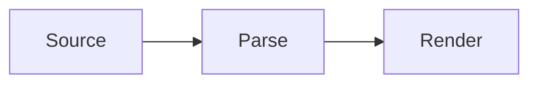

# Heading

@slide[mytitle](ltext)

@cite(kennedy2010units)

- [ ] ~~presenters~~ ~notes~
- [ ] test with ^blog^

@end(up next...)

Math:

$$
x=3
$$

> [!NOTE]
> This is a note

@slide(ltext)

:::thm Pythagorean Theorem {#thm:pyth}
$a^2+b^2=c^2$
:::

@note(talk about this!)
See [@thm:pyth]


@note(talk about this too!)
:::exm Pythatgorean Theorem {#exm:pyth}
$a^2+b^2=c^2$
:::

@note(talk about this too!)

See [@exm:pyth]

```cpp
int main(){
    cout << "Hello, Wrold!";
}
```


@end


@note(talk about this too!)

# Introduction

This prose only appears in document mode.

@slide(steplists, stepleadin, nodoc)
- Documents are the default view
- `@slide` blocks wrap existing content
- Slide mode shows only wrapped content
@end(Switch views with **VFM: Toggle Document / Slide Mode**.)

# Results

@slide
## Overview
@end

@slide[Key figure](ltext, showrefs)
The trend is clear [@tab:data]. This holds in every run.

Results build on prior work.[^1]

Data table. {#tab:data}
| a | b |
| - | - |
| 1 | 2 |

What if we have more on the slide?

and more?

[^1]: Numbers are illustrative.
@end(and on the next slide...)

@slide(nodoc)
Speaker-only material that the document never shows.
@end

Tables should also follow the rule, and since these are laid out like images, then they should revert to single column when nothing else is on the slide.

Presenters notes?

@slide

```alg Quicksort {#alg:quicksort}
% This quicksort algorithm is extracted from Chapter 7, Introduction to Algorithms (3rd edition)
\begin{algorithm}
\caption{Quicksort}
\begin{algorithmic}
\PROCEDURE{Quicksort}{$A, p, r$}
    \IF{$p < r$} 
        \STATE $q = $ \CALL{Partition}{$A, p, r$}
        \STATE \CALL{Quicksort}{$A, p, q - 1$}
        \STATE \CALL{Quicksort}{$A, q + 1, r$}
    \ENDIF
\ENDPROCEDURE
\PROCEDURE{Partition}{$A, p, r$}
    \STATE $x = A[r]$
    \STATE $i = p - 1$
    \FOR{$j = p$ \TO $r - 1$}
        \IF{$A[j] < x$}
            \STATE $i = i + 1$
            \STATE exchange
            $A[i]$ with     $A[j]$
        \ENDIF
        \STATE exchange $A[i]$ with $A[r]$
    \ENDFOR
\ENDPROCEDURE
\end{algorithmic}
\end{algorithm}
```

```mus Cooley's {#mus:cooleys}
X: 1
T: Cooley's
M: 4/4
L: 1/8
K: Emin
|:D2|"Em"EBBA B2 EB|\
    ~B2 AB dBAG|\
    "D"FDAD BDAD|\
    FDAD dAFD|
"Em"EBBA B2 EB|\
    B2 AB defg|\
    "D"afe^c dBAF|\
    "Em"DEFD E2:|
|:gf|"Em"eB B2 efge|\
    eB B2 gedB|\
    "D"A2 FA DAFA|\
    A2 FA defg|
"Em"eB B2 eBgB|\
    eB B2 defg|\
    "D"afe^c dBAF|\
    "Em"DEFD E2:|
```



@end
